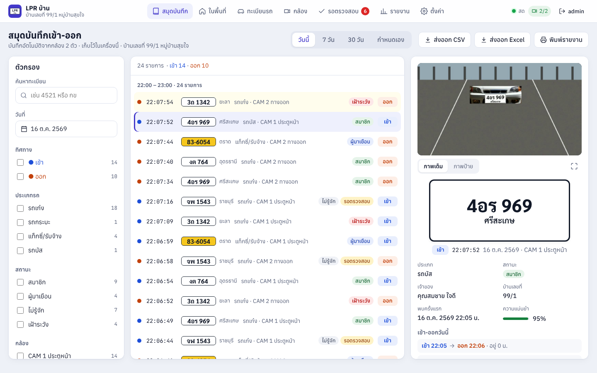

# LPR บ้าน — ระบบตรวจป้ายทะเบียนรถสำหรับบ้านพัก (แบบ 4: สมุดบันทึกเข้า-ออก)

โปรแกรมสำเร็จรูปที่ต่อกล้อง IP (RTSP) 1–8 ตัว ตรวจจับรถ อ่านป้ายทะเบียนไทย (ตัวอักษร เลข และจังหวัด)
บันทึกเหตุการณ์เข้า-ออกพร้อมภาพลงฐานข้อมูลในเครื่อง แสดงผลเป็นหน้าจอ "สมุดบันทึกเข้า-ออก"
และเปิดดูผ่านมือถือ/แท็บเล็ตแบบแอป (PWA) ได้ทั้งในบ้านและนอกบ้าน (ผ่าน Tailscale)



## ดาวน์โหลดและติดตั้ง (ไม่ต้องเขียนโค้ด)

ลิงก์ด้านล่างชี้ไปที่ build ล่าสุดเสมอ (release `lpr-latest`) — ทุกไฟล์ผ่านการทดสอบอัตโนมัติก่อนเผยแพร่
(unit test, self-test ของไฟล์ที่ build แล้ว, ติดตั้งจริงเป็น Windows service แล้วเรียกใช้งาน API, ถอนการติดตั้ง)

| ระบบ | ไฟล์ | วิธีใช้ |
| --- | --- | --- |
| **Windows 10/11 64-bit** (แนะนำ ใช้ได้ทุกเครื่อง) | [LPR-Setup.exe](https://github.com/phakkhinainu-cyber/vision-model-inspector/releases/download/lpr-latest/LPR-Setup.exe) | ดับเบิลคลิกติดตั้ง → ระบบทำงานเป็น Windows service เปิดเองตอนบูต |
| Windows ที่มีการ์ดจอ (NVIDIA / AMD / Intel, DirectX 12) | [LPR-Setup-GPU.exe](https://github.com/phakkhinainu-cyber/vision-model-inspector/releases/download/lpr-latest/LPR-Setup-GPU.exe) | เหมือนรุ่นปกติ แต่ใช้การ์ดจอประมวลผลโมเดล — เหมาะกับเครื่องที่ต่อหลายกล้อง |
| Windows แบบพกพา | [LPR-Portable-windows-x64.zip](https://github.com/phakkhinainu-cyber/vision-model-inspector/releases/download/lpr-latest/LPR-Portable-windows-x64.zip) · [รุ่น GPU](https://github.com/phakkhinainu-cyber/vision-model-inspector/releases/download/lpr-latest/LPR-Portable-windows-x64-GPU.zip) | แตกไฟล์ แล้วเปิด `LPR\LPR.exe` (ไม่ต้องติดตั้ง ไม่มี service) |
| Linux x64 | [LPR-Portable-linux-x64.tar.gz](https://github.com/phakkhinainu-cyber/vision-model-inspector/releases/download/lpr-latest/LPR-Portable-linux-x64.tar.gz) | แตกไฟล์ แล้วรัน `LPR/LPR --server` แล้วเปิด http://localhost:8765 |
| Linux ARM64 (เช่น Raspberry Pi 5, OS 64-bit) | [LPR-Portable-linux-arm64.tar.gz](https://github.com/phakkhinainu-cyber/vision-model-inspector/releases/download/lpr-latest/LPR-Portable-linux-arm64.tar.gz) | เหมือน Linux x64 |
| macOS ชิป Apple (M1–M4) | [LPR-Portable-macos-arm64.tar.gz](https://github.com/phakkhinainu-cyber/vision-model-inspector/releases/download/lpr-latest/LPR-Portable-macos-arm64.tar.gz) | แตกไฟล์ แล้วรัน `LPR/LPR --browser` (ครั้งแรกอาจต้องอนุญาตใน System Settings → Privacy & Security) |
| macOS ชิป Intel | [LPR-Portable-macos-x64.tar.gz](https://github.com/phakkhinainu-cyber/vision-model-inspector/releases/download/lpr-latest/LPR-Portable-macos-x64.tar.gz) | เหมือน macOS ชิป Apple |

รุ่น GPU ใช้การ์ดจอเมื่อพบการ์ดจริงในเครื่อง ถ้าไม่พบหรือใช้ไม่ได้จะกลับไปใช้ CPU เอง (ทั้งสองรุ่นติดตั้งทับกันได้ ข้อมูลเดิมยังอยู่)
ไฟล์ของแต่ละ build อยู่ที่หน้า **Releases** (ชื่อ `lpr-v1.0.0-build.N`) และมี `SHA256SUMS.txt` ไว้ตรวจไฟล์

หลังติดตั้ง:
1. เปิดโปรแกรม "LPR บ้าน" → ตั้งชื่อผู้ใช้/รหัสผ่านผู้ดูแลระบบ และชื่อบ้าน
2. เมนู **กล้อง** → **เพิ่มกล้อง** → กรอกลิงก์ RTSP, ชื่อผู้ใช้/รหัสผ่านกล้อง → **ทดสอบการเชื่อมต่อ**
   → วาด **เส้นเสมือน** ที่รถต้องข้าม (และโซน ROI ถ้าต้องการ) → ตั้งบทบาท ทางเข้า/ทางออก/สองทาง → บันทึก
   (ยังไม่มีกล้อง? กด **ใช้วิดีโอตัวอย่าง (โหมดจำลอง)** เพื่อลองระบบ)
3. ปล่อยให้ระบบอ่านป้ายรถจริงสัก 1–2 วัน แล้วปรับค่าความไวและเวลากันบันทึกซ้ำในหน้า **ตั้งค่า**

คู่มือ: [คู่มือผู้ใช้](docs/user-manual.md) · [ดูผ่านมือถือ/นอกบ้าน (Tailscale)](docs/mobile-setup.md) ·
[ฝึกโมเดลด้วยภาพป้ายของคุณ](docs/fine-tune.md) · [คู่มือนักพัฒนา](docs/developer.md) · [ไลเซนส์](docs/licenses.md) ·
[prompt ต้นฉบับ (สเปกของงาน)](docs/prompt-แบบ4.md)

## ความสามารถ

- **จับภาพอัตโนมัติ**: sub-stream สำหรับตรวจจับ main-stream สำหรับภาพบันทึก → ตรวจความเคลื่อนไหวใน ROI (ไม่มีความเคลื่อนไหว = ไม่รันโมเดล)
  → YOLO11 ตรวจจับรถ (รถยนต์/จักรยานยนต์/บัส/บรรทุก) + ByteTrack → หาป้ายในกรอบรถ → แก้มุมเอียง/CLAHE/เพิ่มความคม
  → OCR ภาษาไทย PP-OCRv5 (th_PP-OCRv5_mobile_rec) → โหวต 5–15 เฟรมที่คมที่สุด → ข้ามเส้นเสมือนหรือรถออกจากภาพ = 1 เหตุการณ์
- บันทึกภาพเต็มเฟรม, ภาพป้าย, ภาพย่อ และคลิป 3 วินาทีก่อน – 5 วินาทีหลัง (WebM) · กันบันทึกซ้ำ · รถที่อ่านไม่ได้ก็ยังบันทึก
- ความมั่นใจต่ำ/ผลโหวตก้ำกึ่ง → คิว **รอตรวจสอบ** (แก้เร็วด้วยคีย์บอร์ด เลือกผลอ่านอันดับรองได้ด้วย Alt+1–3)
- กลางคืน/IR: สลับค่าประมวลผลอัตโนมัติตามความสว่าง · ทิศทางเข้า/ออกจากบทบาทกล้องหรือทิศที่ข้ามเส้น
- ประเภทรถจาก YOLO + สีป้าย (ขาว/เขียว/น้ำเงิน/เหลือง/แดง) · จังหวัด 77 จังหวัดด้วย rapidfuzz · เก็บทั้ง plate_raw และ plate_norm
- จับคู่ เข้า→ออก เป็นการเข้าพื้นที่ 1 ครั้ง คำนวณเวลาที่อยู่ · รถที่อยู่ในพื้นที่ตอนนี้ · เกินเวลา = ไม่พบการออก
- หน้าจอแบบ 4 ครบ (ตัวกรอง/ไทม์ไลน์สดผ่าน WebSocket/รายละเอียด) · ทะเบียนรถ (นำเข้า/ส่งออก Excel) · กล้อง (ภาพสด, วาด ROI/เส้น)
  · รายงาน (รายวัน/รายเดือน/รายชั่วโมง/อยู่นานผิดปกติ) · ตั้งค่า (ทุกค่าที่ปรับได้) · ผู้ใช้ admin/viewer · audit log
- ส่งออก CSV / Excel / PDF (ฝังฟอนต์ Sarabun จัดวางสระไทยถูกต้อง) · วันที่ พ.ศ. เวลา 24 ชม. เขตเวลา Asia/Bangkok
- PWA ติดตั้งบน Android/iPhone/iPad · Web Push (VAPID) · Telegram Bot · LINE Messaging API (ไม่ใช้ LINE Notify ที่ปิดบริการแล้ว)
- ความปลอดภัย: รหัสผ่าน argon2, จำกัดการล็อกอินผิด, จำเครื่อง 30 วัน, กัน CSRF, รหัสผ่านกล้องเก็บใน Windows Credential Manager
- ระบบ: watchdog รีสตาร์ต process กล้องที่ค้าง/หลุด · สำรองฐานข้อมูลทุกวัน 03:00 (เก็บ 14 ชุด) · ลบภาพเก่า 90 วัน · เตือนดิสก์เหลือน้อย · log หมุนเวียน
- ใช้ได้ทุกเครื่อง: CPU อย่างเดียวก็ทำงานได้ (เลือก CUDA/DirectML ให้อัตโนมัติถ้ามี) · Windows/Linux/macOS · ไม่โหลดอะไรจากอินเทอร์เน็ตตอนใช้งาน

## โครงสร้างโปรเจกต์

```
lpr/
  backend/lpr/        Python: FastAPI, กล้อง, vision, ฐานข้อมูล, แจ้งเตือน
    camera/           อ่าน RTSP/ไฟล์, process ต่อกล้อง, ring buffer/คลิป, watchdog
    vision/           YOLO ONNX, ByteTrack, ตรวจป้าย, ปรับภาพ, OCR engines, โหวต
    plates/           แยกวิเคราะห์ป้ายไทย, 77 จังหวัด, สีป้าย, ประเภทรถ
    events/           กันซ้ำ, สถานะตรวจสอบ, จับคู่เข้า-ออก
    api/              REST API + WebSocket + ล็อกอิน
    db/               SQLAlchemy models + Alembic migrations (SQLite WAL)
  frontend/           React + TypeScript + Vite (PWA)
  models/             ไฟล์โมเดล ONNX (ดาวน์โหลดด้วย tools/fetch_models.py)
  demo/               วิดีโอตัวอย่างสำหรับโหมดจำลอง
  tools/              สร้าง/ดาวน์โหลดโมเดล, วัดความแม่นยำ, เก็บภาพป้าย, ฝึกโมเดล
  packaging/          PyInstaller, Inno Setup, WinSW (Windows service)
  scripts/            เปิดจากซอร์ส (Windows .bat / macOS-Linux .sh)
  tests/              unit/integration tests (pytest)
  docs/               คู่มือภาษาไทย + ภาพหน้าจอ
```

## รันจากซอร์ส (นักพัฒนา)

```bash
# Windows: scripts\start-windows.bat     macOS/Linux: ./scripts/start.sh
python -m venv .venv && . .venv/bin/activate          # Windows: .venv\Scripts\activate
pip install -r requirements/runtime.txt -r requirements/desktop.txt -r requirements/dev.txt
python tools/fetch_models.py                           # ดาวน์โหลดโมเดล ONNX (~34 MB)
python tools/fetch_assets.py                           # เฉพาะเมื่อได้ซอร์สจากสำเนาใน Google Drive: ฟอนต์/ไอคอน/วิดีโอตัวอย่าง
(cd frontend && npm ci && npm run build)
PYTHONPATH=backend python -m lpr                        # หรือ --server / --browser / --home D:\LPR
PYTHONPATH=backend python -m pytest                     # ทดสอบ (155 tests)
```

## License

AGPL-3.0-or-later (เพราะใช้โมเดล/โค้ดของ Ultralytics YOLO ซึ่งเป็น AGPL-3.0) — รายละเอียดใน [docs/licenses.md](docs/licenses.md)
