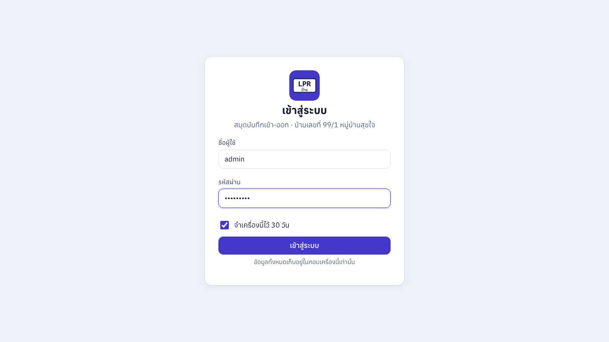
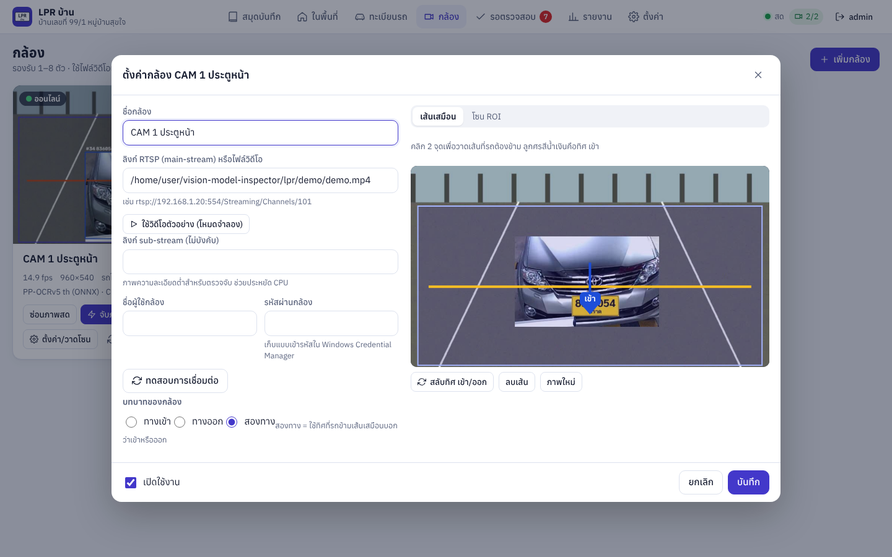
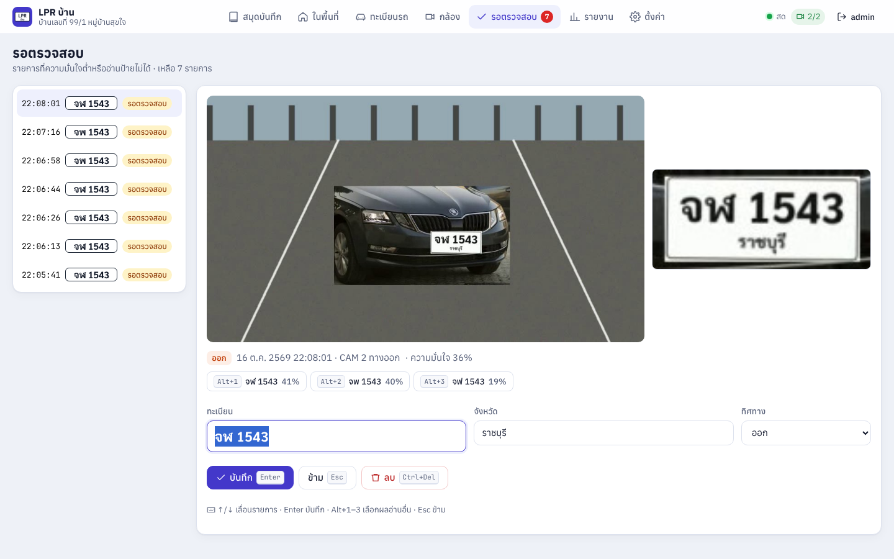
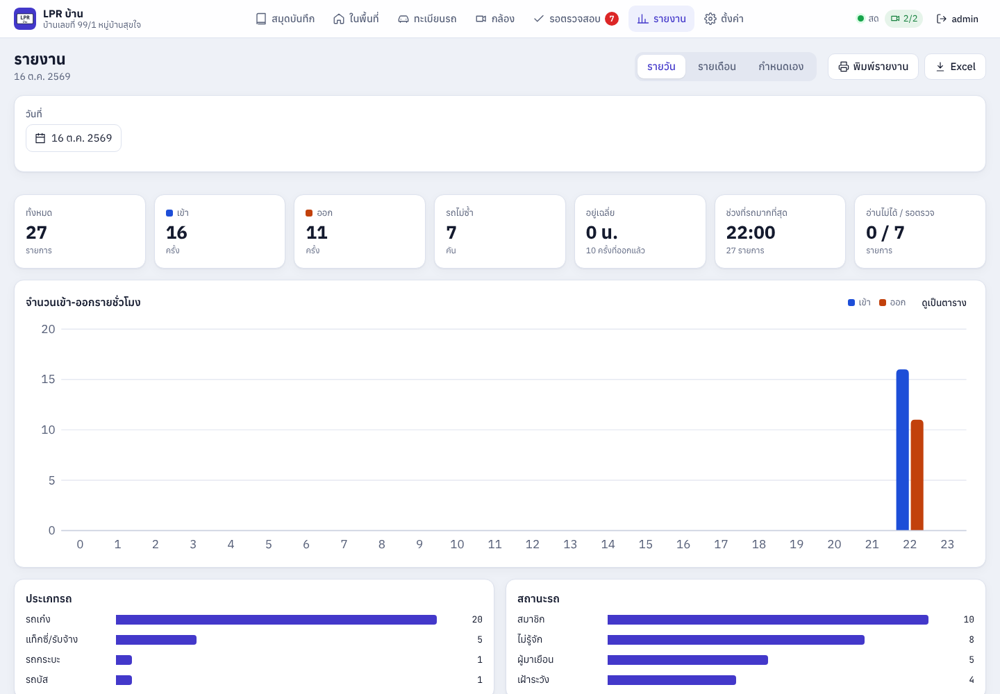
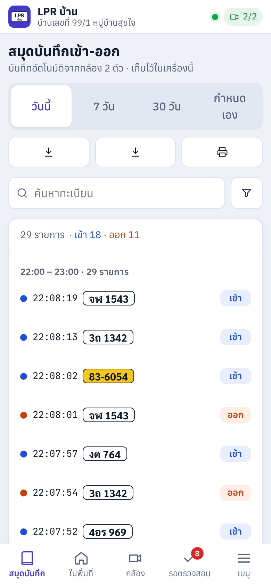
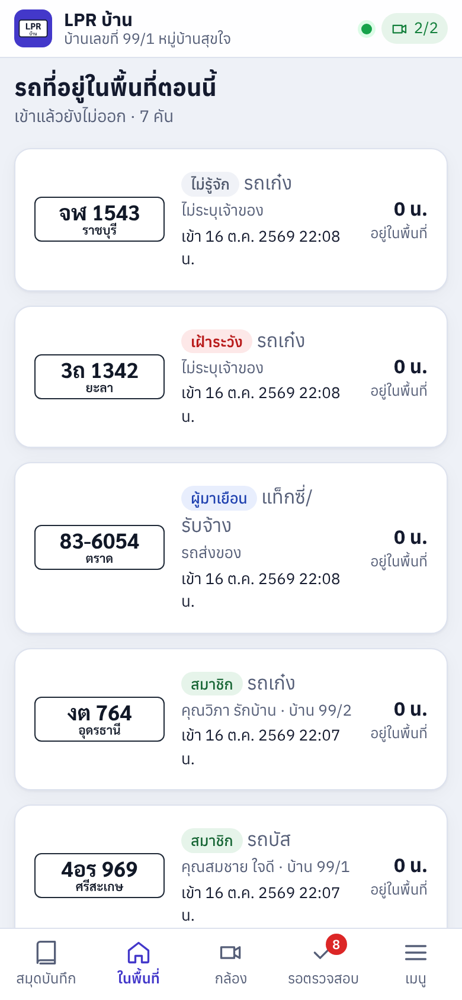

# คู่มือผู้ใช้ LPR บ้าน

ระบบตรวจป้ายทะเบียนรถสำหรับบ้านพัก · เวอร์ชัน 1.0.0 · [ดาวน์โหลดคู่มือนี้เป็น PDF](https://github.com/phakkhinainu-cyber/vision-model-inspector/releases/download/lpr-latest/LPR-Manual-TH.pdf)

## 1. สิ่งที่ต้องมี

- คอม Windows 10/11 64-bit ที่เปิดไว้ตลอด (Core i5 รุ่น 10 ขึ้นไป หรือ Ryzen 5, RAM 8–16 GB) — CPU อย่างเดียวรองรับ 2 กล้อง
  ถ้ามีการ์ดจอ (NVIDIA / AMD / Intel Arc หรือการ์ดในตัวรุ่นใหม่ที่รองรับ DirectX 12) ใช้รุ่น GPU เพื่อต่อกล้องได้มากขึ้น
- กล้อง IP ที่ส่งภาพแบบ RTSP ต่อสาย LAN ถึงคอม (ดูวิธีติดกล้องในหัวข้อ 9)
- ถ้าจะดูจากมือถือนอกบ้าน: บัญชี Tailscale (ฟรี) — ดู [mobile-setup.md](mobile-setup.md)

## 2. ติดตั้ง

1. ดาวน์โหลดตัวติดตั้ง แล้วดับเบิลคลิก (ต้องเป็นผู้ดูแลเครื่อง)
   - รุ่นปกติ ใช้ได้ทุกเครื่อง: [LPR-Setup.exe](https://github.com/phakkhinainu-cyber/vision-model-inspector/releases/download/lpr-latest/LPR-Setup.exe)
   - รุ่น GPU สำหรับเครื่องที่มีการ์ดจอ: [LPR-Setup-GPU.exe](https://github.com/phakkhinainu-cyber/vision-model-inspector/releases/download/lpr-latest/LPR-Setup-GPU.exe)
     (ถ้าไม่พบการ์ดจอ จะใช้ CPU เหมือนรุ่นปกติ — ดูว่าใช้อะไรอยู่ที่ ตั้งค่า → ระบบ → การ์ดจอ / กล้อง)
   - Windows SmartScreen อาจเตือนเพราะตัวติดตั้งยังไม่ได้ลงลายเซ็นดิจิทัล: กด **More info → Run anyway**
2. เลือก **โฟลเดอร์เก็บข้อมูล** (ค่าเริ่มต้น `D:\LPR` ถ้ามีไดรฟ์ D: ไม่เช่นนั้น `C:\ProgramData\LPR`)
   ข้างในจะมี `data\lpr.db` (ฐานข้อมูล), `data\images\ปี\เดือน\วัน\` (ภาพ), `logs\`, `backup\`
3. ตัวเลือก (แนะนำให้เลือกไว้ทั้งหมด):
   - **ติดตั้งเป็น Windows service** — ระบบจับภาพทำงานเบื้องหลังตลอด เปิดเองเมื่อเปิดเครื่อง ปิดหน้าต่างแล้วยังทำงาน
   - **อนุญาตมือถือ/แท็บเล็ตในวง LAN** — เปิดพอร์ต 8765 ใน Windows Firewall เฉพาะเครือข่ายส่วนตัว
4. เสร็จแล้วโปรแกรมจะเปิดขึ้นมาเอง (มีไอคอนที่ system tray มุมขวาล่าง)

> ถอนการติดตั้งได้ที่ การตั้งค่า Windows → แอป → LPR บ้าน — ข้อมูลในโฟลเดอร์เก็บข้อมูลจะไม่ถูกลบ

## 3. เริ่มใช้งานครั้งแรก

1. กรอก **ชื่อบ้าน**, **ชื่อผู้ใช้** และ **รหัสผ่าน** ของผู้ดูแลระบบ (admin) แล้วกด สร้างบัญชี
2. ไปที่เมนู **กล้อง** → **เพิ่มกล้อง**

| ช่อง | กรอกอะไร |
| --- | --- |
| ชื่อกล้อง | เช่น `CAM 1 ประตูหน้า` |
| ลิงก์ RTSP (main-stream) | ดูจากคู่มือ/แอปกล้อง เช่น Hikvision `rtsp://192.168.1.20:554/Streaming/Channels/101`, Dahua `rtsp://192.168.1.20:554/cam/realmonitor?channel=1&subtype=0` |
| ลิงก์ sub-stream | (ไม่บังคับ) ภาพความละเอียดต่ำ เช่น `.../Channels/102` หรือ `subtype=1` ช่วยประหยัด CPU |
| ชื่อผู้ใช้ / รหัสผ่านกล้อง | รหัสผ่านถูกเก็บแบบเข้ารหัสใน Windows Credential Manager |
| บทบาท | **ทางเข้า**, **ทางออก** หรือ **สองทาง** (ใช้ทิศที่รถข้ามเส้นบอกว่าเข้าหรือออก) |

3. กด **ทดสอบการเชื่อมต่อ** — ถ้าสำเร็จจะเห็นภาพจากกล้อง
4. **เส้นเสมือน**: คลิก 2 จุดบนภาพ ตรงตำแหน่งที่รถทุกคันต้องขับผ่าน ลูกศรสีน้ำเงิน = ทิศ **เข้า** (กด สลับทิศ ถ้ากลับด้าน)
5. **โซน ROI** (ไม่บังคับ): คลิกล้อมบริเวณที่ต้องการตรวจ เช่น เฉพาะถนนหน้าประตู เพื่อไม่ให้รถที่จอดหรือวิ่งบนถนนนอกบ้านถูกนับ
6. กด **บันทึก** — ระบบเชื่อมต่อกล้องทันที

> ไม่มีกล้อง? กด **ใช้วิดีโอตัวอย่าง (โหมดจำลอง)** ระบบจะเล่นวิดีโอรถวิ่งผ่านแทนกล้อง หรือใส่พาธไฟล์วิดีโอของคุณเอง เช่น `D:\clips\gate.mp4`

## 4. หน้าสมุดบันทึกเข้า-ออก

- **ส่วนหัว**: ช่วงเวลา วันนี้ / 7 วัน / 30 วัน / กำหนดเอง · ปุ่ม ส่งออก CSV · ส่งออก Excel · พิมพ์รายงาน (PDF)
- **ซ้าย – ตัวกรอง**: ค้นหาทะเบียน (พิมพ์บางส่วนได้ เช่น `4521` หรือ `กข`), วันที่ (ปฏิทิน พ.ศ.), ทิศทาง, ประเภทรถ, สถานะ, กล้อง
  ตัวเลขข้างแต่ละตัวเลือกคือจำนวนรายการ
- **กลาง – ไทม์ไลน์**: จัดกลุ่มตามชั่วโมง รายการใหม่ขึ้นบนสุดแบบสด จุดสีน้ำเงิน = เข้า สีส้ม = ออก
  ป้ายทะเบียนแสดงสีตามสีป้ายจริง (ขาว/เหลือง/แดง ฯลฯ) เลื่อนลงเพื่อโหลดเพิ่ม ใช้ปุ่ม ↑/↓ เลือกรายการได้
- **ขวา – รายละเอียด**: ภาพจากกล้อง (คลิกขยายเต็มจอ, สลับ ภาพเต็ม/ภาพป้าย, เล่นคลิป), ป้ายทะเบียนจำลองขนาดใหญ่,
  ประเภท, สถานะ, เจ้าของ, บ้านเลขที่, พบครั้งแรก, ความแม่นยำ, รายการ เข้า→ออก วันนี้ พร้อมเวลาที่อยู่, สถิติ 30 วัน
  - **ดูประวัติทั้งหมด** · **แก้ไขข้อมูลรถ** · **แก้ไขทะเบียนที่อ่านผิด**
  - รถที่ยังไม่รู้จัก กด **สมาชิก / ผู้มาเยือน / เฝ้าระวัง** ได้ในคลิกเดียว

สถานะการตรวจสอบของแต่ละรายการ:

| สถานะ | ความหมาย |
| --- | --- |
| ปกติ | อ่านได้ชัด ความมั่นใจสูงกว่าเกณฑ์ (ค่าเริ่มต้น 80%) |
| รอตรวจสอบ | ความมั่นใจต่ำ, รูปแบบป้ายแปลก, ป้ายแดง, อ่านจังหวัดไม่ได้ หรือหลายเฟรมอ่านได้ไม่ตรงกัน |
| อ่านไม่ได้ | เห็นรถแต่อ่านป้ายไม่ได้/ไม่มีป้าย (ยังบันทึกภาพไว้) |
| แก้ไขแล้ว | ผู้ใช้แก้ไขหรือยืนยันแล้ว (เก็บทะเบียนที่อ่านได้เดิมไว้) |

## 5. รอตรวจสอบ (แก้เร็วด้วยคีย์บอร์ด)

| ปุ่ม | ทำอะไร |
| --- | --- |
| Enter | บันทึก (ถ้าไม่ได้แก้ = ยืนยันว่าถูก) |
| Alt+1 / Alt+2 / Alt+3 | เลือกผลอ่านอื่นที่ระบบโหวตได้ |
| ↑ / ↓ | รายการก่อนหน้า / ถัดไป |
| Esc | ข้าม |
| Ctrl+Delete | ลบรายการ |

เว้นช่องทะเบียนว่างแล้วกด Enter = ยืนยันว่าอ่านไม่ได้

## 6. หน้าอื่นๆ

- **ในพื้นที่**: รถที่เข้าแล้วยังไม่ออกตอนนี้ พร้อมเวลาที่อยู่ · รายการ ไม่พบการออก (เกิน 24 ชม. ตั้งได้)
- **ทะเบียนรถ**: เพิ่ม/แก้/ลบ สมาชิก ผู้มาเยือน เฝ้าระวัง · นำเข้า/ส่งออก Excel (คอลัมน์: ทะเบียน, จังหวัด, ประเภทรถ, สถานะ, เจ้าของ, บ้านเลขที่, โทรศัพท์, หมายเหตุ)
- **กล้อง**: ภาพสดพร้อมกรอบรถ/เส้น/โซน, สถานะ (ออนไลน์/กำลังเชื่อมต่อ/ผิดพลาด), fps, โหมดกลางคืน,
  **จับภาพเดี๋ยวนี้** (วิเคราะห์ภาพปัจจุบันทันที), **บันทึกด้วยมือ** (กรณีพิเศษ), รีสตาร์ตกล้อง
- **รายงาน**: สรุปรายวัน/รายเดือน, กราฟเข้า-ออกรายชั่วโมงและรายวัน, ประเภท/สถานะรถ, รถที่อยู่นานผิดปกติ, พิมพ์ PDF

## 7. ตั้งค่า

ทุกค่าที่ปรับได้อยู่ในเมนู **ตั้งค่า** (เฉพาะ admin แก้ได้) ค่าที่ควรปรับหลังใช้งานจริง 1–2 วัน:

| ค่า | ค่าเริ่มต้น | เมื่อไรควรปรับ |
| --- | --- | --- |
| เกณฑ์ความมั่นใจ | 0.80 | รายการเข้าคิวรอตรวจสอบมากเกินไป → ลดเป็น 0.7 · อ่านผิดแต่ไม่เข้าคิว → เพิ่ม |
| กันบันทึกซ้ำ (วินาที) | 60 | รถจอดรอหน้าประตูนานแล้วถูกบันทึกซ้ำ → เพิ่ม |
| ความไวการตรวจจับรถ | 0.35 | พลาดรถ → ลด · จับของที่ไม่ใช่รถ → เพิ่ม |
| ความไวการตรวจความเคลื่อนไหว | 0.004 | ต้นไม้ไหว/ไฟส่องทำให้ทำงานตลอด → เพิ่ม หรือวาดโซน ROI |
| ความสว่าง = โหมดกลางคืน | 70 | — |
| ลบภาพที่เก่ากว่า / เก็บข้อมูลแถว | 90 / 365 วัน | ดิสก์เต็มเร็ว → ลดวันเก็บภาพ |
| เวลาสำรองข้อมูล / จำนวนชุด | 03:00 / 14 | ตั้งโฟลเดอร์สำรองเป็นไดรฟ์อื่น/USB |

หมวดอื่น: การแจ้งเตือน (Web Push, Telegram, LINE + ปุ่มทดสอบ), เครือข่าย (พอร์ต 8765, HTTPS self-signed),
ผู้ใช้ (admin = แก้ไขได้, viewer = ดูอย่างเดียว), บันทึกการใช้งาน (ทุกการแก้ไข ลบ ส่งออก ล็อกอิน), ระบบ, บัญชีของฉัน (เปลี่ยนรหัสผ่าน)

## 8. มือถือและแท็บเล็ต

เปิด `http://<IP คอม>:8765` ในวง LAN ได้ทันที ถ้าจะติดตั้งเป็นแอป รับแจ้งเตือน และดูนอกบ้าน ให้ทำตาม [mobile-setup.md](mobile-setup.md)

## 9. ติดกล้องให้อ่านป้ายแม่น (สำคัญกว่าตัวโปรแกรม)

- ติดตรงจุดที่รถชะลอหรือหยุด เช่นหน้าประตูรั้ว ห่างจากป้าย 3–8 เมตร มองป้ายเกือบตรง (เอียงไม่เกิน ~30°)
- ซูมจนป้ายในภาพกว้างอย่างน้อย 130–150 พิกเซล (ดูได้จาก "ภาพป้าย" ในหน้ารายละเอียด)
- อย่าหันกล้องสวนแสงแดด/ไฟหน้ารถ กลางคืนตั้งชัตเตอร์เร็ว (1/1000 วินาทีขึ้นไป หรือโหมด LPR) และเปิดไฟหน้าประตู
- ตั้ง IP กล้องแบบคงที่ เปลี่ยนรหัสผ่านเริ่มต้น เปิด sub-stream ไว้ด้วย
- ใช้สาย LAN (ไม่แนะนำ Wi-Fi) และ UPS สำหรับคอมกับ switch

## 10. แก้ปัญหาเบื้องต้น

| อาการ | วิธีแก้ |
| --- | --- |
| กล้องขึ้น "กำลังเชื่อมต่อ" ตลอด | ตรวจ IP/พอร์ต/ลิงก์ RTSP/รหัสผ่าน ด้วยปุ่ม ทดสอบการเชื่อมต่อ · ลองเปิดลิงก์เดียวกันใน VLC |
| อ่านป้ายไม่ออกตอนกลางคืน | ส่วนใหญ่แก้ที่กล้อง: ชัตเตอร์เร็วขึ้น ลด IR สะท้อน เพิ่มไฟ |
| อ่านผิดบ่อยบางตัวอักษร | แก้ในคิวรอตรวจสอบ แล้วเปิด "เก็บภาพป้ายไว้ฝึกโมเดล" เพื่อนำไปฝึก ([fine-tune.md](fine-tune.md)) |
| CPU สูง | ใส่ลิงก์ sub-stream, วาดโซน ROI, ลด "จำนวนเฟรมที่ตรวจจับต่อวินาที" |
| เปิดหน้าต่างไม่ขึ้น | เปิดผ่านเบราว์เซอร์ที่ http://127.0.0.1:8765 (เมนู Start → LPR บ้าน → เปิดในเบราว์เซอร์) |
| ลืมรหัสผ่าน admin | ให้ admin คนอื่นรีเซ็ตในเมนู ผู้ใช้ หรือดูวิธีใน [developer.md](developer.md#reset-admin) |
| ดู log | `<ที่เก็บข้อมูล>\logs\lpr.log` และ `C:\ProgramData\LPR\service-logs\` |

## 11. ความเป็นส่วนตัว (PDPA)

ข้อมูลทั้งหมดอยู่ในคอมเครื่องนี้ ไม่ส่งออกนอกเครื่อง ยกเว้นการแจ้งเตือนที่คุณเปิดเอง (Telegram/LINE/Web Push)
ป้ายทะเบียนที่ผูกกับชื่อเจ้าของเป็นข้อมูลส่วนบุคคล ถ้าใช้ในพื้นที่ส่วนกลางควรติดป้ายแจ้งว่ามีกล้อง กำหนดระยะเก็บข้อมูล
(หน้าตั้งค่า) และจำกัดผู้ที่ดูได้ (สิทธิ์ viewer) — ข้อนี้เป็นข้อมูลทั่วไป ไม่ใช่คำแนะนำทางกฎหมาย
